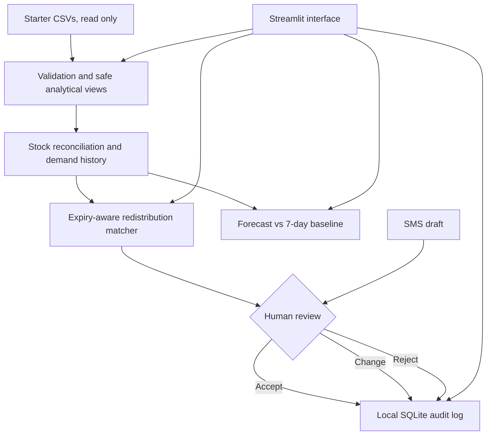

# ABBIS-Lite: finds blood that is about to expire in one place and is needed in another

Terumo BCT Africa Hackathon 2026 · Challenge area: **Redistribution**

> **Data notice:** the organisers' one-year starter dataset is synthetic and modelled on Kenya. No real donor, patient or facility records are used anywhere. Findings are not real hospital performance.

## The problem

**User:** a regional blood-service coordinator who must decide where stock should move each week.

**Today:** records are imperfect, so one trusted view of stock is hard to get. A hospital can run short of a blood group while a regional or satellite centre holds the same group close to expiry.

**What the data shows (starter dataset):**
- 8,620 of 37,147 RBC and whole-blood records (23.2%) were expired or discarded after temperature exposure.
- 87.1% of 17,430 hospital requests were fully fulfilled, so 12.9% were not.
- 1,046 of 35,181 transfers have no receipt confirmation.
- 4,607 valid temperature readings are outside 2–6°C.
- 506 donor records have no blood group, and 452 extra donor rows share a composite identity.

Full profile: [`docs/DATA_QUALITY_FINDINGS.md`](docs/DATA_QUALITY_FINDINGS.md).

## What we built

- **What works now:** data profiling and quality flags, safe analytical views, stock reconciliation (final snapshot vs unit ledger: 8,666 units on both, difference zero), a Streamlit dashboard, an expiry-aware redistribution matcher (18 candidate moves in the supplied snapshot), rolling forecast comparison with automatic fallback, SMS drafts (max 160 characters), Accept / Change / Reject review and a local audit log. 8 automated tests pass.
- **What is mocked or not finished:** no live blood-service integration, no real dispatch (Accept records a decision, it does not move stock), no SMS sending, no user login or roles, no tamper-proof audit, no offline sync between devices. See "Known limits".

Demo video : **[PASTE VIDEO LINK]**
Live demo: none (runs locally in minutes, see below) · Test log-in: not needed

## How to run it

Needs Python 3.11 or newer. About 5 minutes on a normal laptop.

```bash
git clone https://github.com/2025bcs068-prog/Abbis_Lite.git
cd Abbis_Lite
chmod +x run.sh
./run.sh
```

`run.sh` creates a virtual environment, installs the packages, profiles the raw data, runs the forecast comparison and starts the app. Open **http://localhost:8501**.

Manual steps (also for Windows):

```bash
python3 -m venv .venv
source .venv/bin/activate          # Windows: .venv\Scripts\activate
python -m pip install -r requirements.txt
python -m scripts.prepare_data
python -m scripts.evaluate_forecast
streamlit run app.py
```

Run the tests: `python -m pytest -q`

**Suggested 3-minute path for a judge:** Overview → Data quality → Redistribution planner (open a proposal, press Reject or Accept) → Demand forecast → Decision audit.

## Architecture



- `app.py`: Streamlit screens.
- `abbis/engine.py`: loading, quality checks, matcher, forecast evaluation, audit helpers.
- `scripts/`: data preparation and forecast evaluation.
- `data/raw/`: original data, never modified. `data/local/`: local decision log.

**Where it sits in a wider system:** ABBIS-Lite is a decision-support layer. It reads the same kinds of tables a blood-bank system holds (facilities, units, requests, transfers, temperature logs) and writes only a review decision. A real deployment would read from the blood-bank system and send approved decisions back to it. No standards (FHIR, ISBT 128, DHIS2) are implemented yet; blood group and component fields are the natural place to map ISBT 128 codes. More detail: [`docs/ARCHITECTURE.md`](docs/ARCHITECTURE.md).

## AI and data

- **What the feature does:** estimates 7-day demand per facility, blood group and component, then checks whether stock elsewhere can safely cover a projected shortfall.
- **Baseline we compared against:** 7-day mean.
- **Result:** baseline WAPE **1.016** vs best candidate (28-day moving average) WAPE **0.953**, on HSP-018 · A+ · RBC, 8 rolling-origin folds, 7-day horizon, over the supplied year. The weekly seasonal naive method scored 1.189.

| Method | WAPE | MAE |
|---|---:|---:|
| 7-day mean (baseline) | 1.016 | 1.923 |
| 28-day moving average | 0.953 | 1.804 |
| Weekly seasonal naive | 1.189 | 2.250 |

  The candidate is about 6.2% better, but it is still above our 0.50 confidence limit. So ABBIS does **not** present it as reliable and uses the 7-day baseline. This is a deliberate safeguard.
- **How a user sees the reason:** each proposal shows source, destination, blood group, component, projected demand, safe stock, reserve kept at the source, expiry, route time and cold-chain checks.
- **Who approves (Accept / Change / Reject):** the coordinator. A reason is required for Change or Reject. Each decision is saved with reviewer, quantity, reason and time. One decision per recommendation.
- **If the AI is wrong or offline:** the matcher is rule-based and the forecast falls back to the baseline when accuracy is poor. The app makes no internet calls. Nothing is dispatched automatically, so a wrong proposal is stopped by the reviewer.

**Safety rules in the matcher:** exact blood-group and component match only; units must be tested non-reactive and in stock; temperature-exposed units are excluded; the source needs adequate cold-chain readiness; the destination needs fridge backup or at least 90% grid reliability; the route must be 12 typical hours or less; at least 2 days of shelf life must remain on arrival.

## Data

Starter dataset tables used: `facilities`, `donors`, `donations`, `units`, `requests`, `transfers`, `routes`, `daily_stock`, `temperature_logs`, `power_outages`. Dictionary: [`data/raw/DATA_DICTIONARY.md`](data/raw/DATA_DICTIONARY.md).

No other data is used. No real donor, patient or facility data.

Handling of imperfect data: unknown blood groups are treated as missing, never guessed. Sentinel temperatures (-99, 99.9, 0.0) are masked in the analysis view only. Transfers without `received_at` stay "pending confirmation". Raw facility labels are kept next to canonical facility IDs.

## African conditions

- **Weak connectivity:** runs fully on one laptop with a local SQLite file, and needs no internet after install. SMS drafts are short (160 characters) so staff can send them from any phone.
- **Weak power:** the matcher checks destination fridge backup and grid reliability before it proposes a move, and checks source cold-chain readiness.
- **Distance and roads:** route time and shelf life on arrival are checked for every proposal.
- **Another site or country:** replace the CSVs in `data/raw/` with files that have the same columns as the data dictionary, then run `python -m scripts.prepare_data`.
- **Not done yet:** local-language screens and offline sync between devices.

## AI tools we used

- **ChatGPT:** data profiling, code drafting, debugging, test design, documentation.
- **Claude:** project planning and design discussion; restructuring this README to the organisers' template and checking that the project installs, passes its tests and starts.


## Team

| Name | Role | Country | Presenting Friday (in person / online) |
|------|------|---------|-----------------------------------------|
| Biyimbwa Elijah Simwogerere | Team lead, backend, architecture | Uganda | [online] |
| Kissa Keith Ndiema | Backend, AI/data | Uganda | [online] |
| Okori Sadrach | AI/data | Uganda | [ online] |
| Tusiime Betty | Frontend | Uganda | [online] |
| Kisembo Stephen | AI/data, frontend | Uganda | [online] |

## Known limits and next steps

- Forecast accuracy is weak on sparse series (WAPE above 0.50), so the baseline is used. Next: pool similar facilities and add more history.
- Acceptance records a decision only. Next: connect to a blood-bank system so an approved move creates a real transfer.
- No login, roles or tamper-proof audit. Next: add authentication and a signed audit trail.
- SMS is drafted, not sent. Next: connect an SMS gateway.
- Proposals are decision support, not a clinical compatibility check or a dispatch order. ABBIS-Lite is a hackathon prototype and must not be used to authorise transfusion or dispatch blood.
