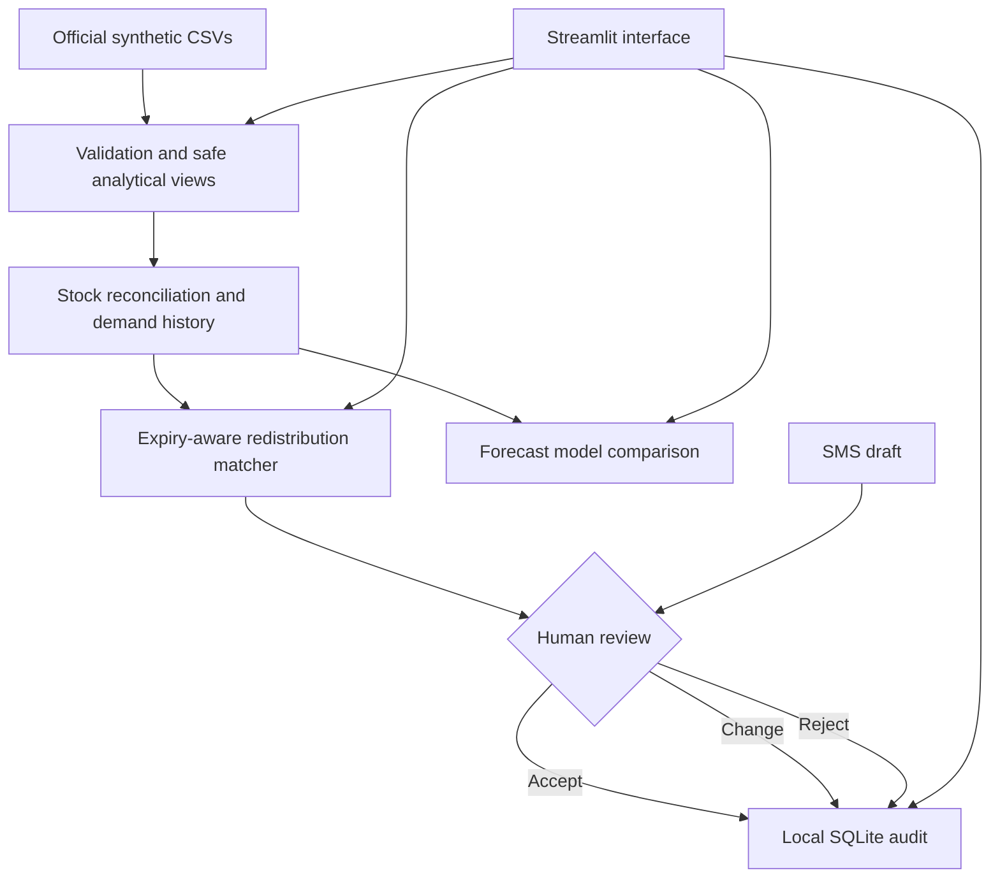

# ABBIS Lite architecture

## Modules

- `app.py`: Streamlit user interface and page navigation.
- `abbis/engine.py`: data loading, safe analytical views, quality checks, overview metrics, redistribution matching, rolling-origin forecast evaluation and local audit helpers.
- `scripts/prepare_data.py`: creates a JSON quality report and separate normalized CSV views under `data/processed/`.
- `scripts/evaluate_forecast.py`: runs the reproducible HSP-018 / A+ / RBC forecast comparison.
- `data/raw/`: immutable source dataset.
- `data/local/decisions.sqlite`: local reviewer decisions; never a live dispatch database.

## Redistribution rule

The planner estimates seven-day demand using the previous 28 days of requests. It compares that estimate with safe unit stock at the receiving hospital. Source stock is filtered to `in_stock`, non-temperature-exposed units with enough remaining shelf life for the observed route. It retains a source reserve based on recent transfer outflow, only matches exact group/component pairs, and excludes facilities without adequate cold-chain readiness. Suggestions are ranked by quantity, expiry date and route time.

## Human control and limitations

Accept/Change/Reject is recorded in a local SQLite file with reviewer label, timestamp and reason. Reviewer identity is not authenticated, the log is not tamper-proof, and accepted decisions do not dispatch or move blood. This is an evaluation prototype only.
